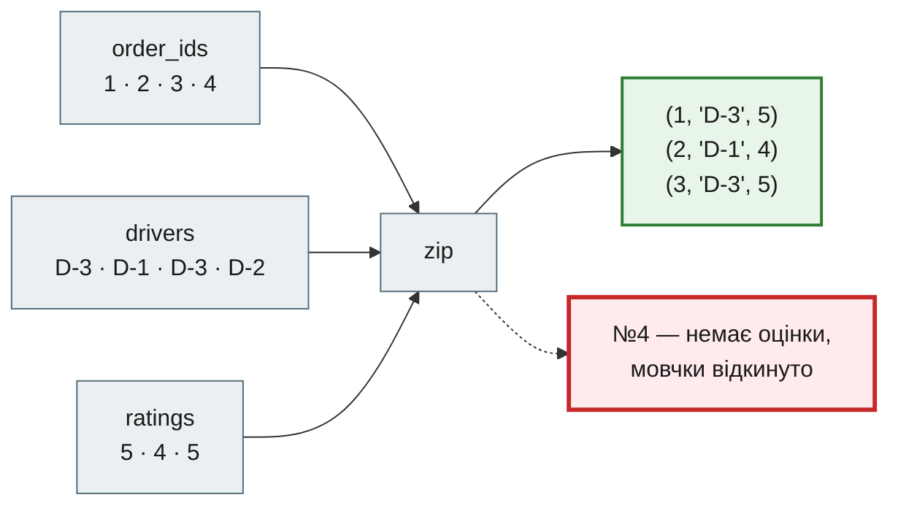
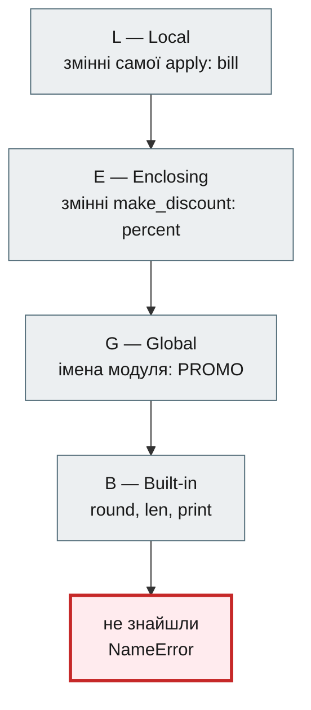
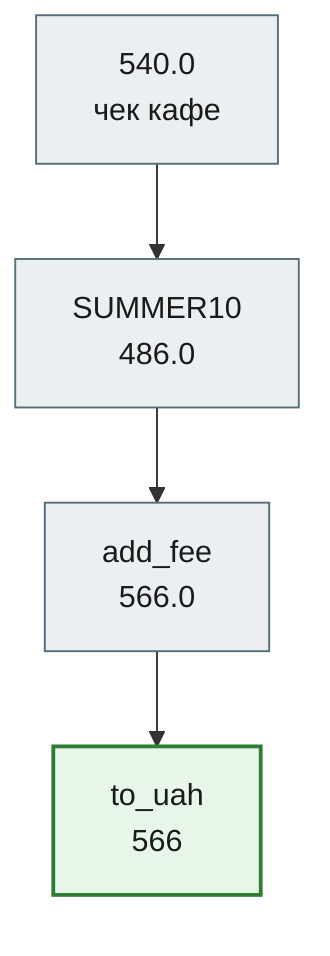
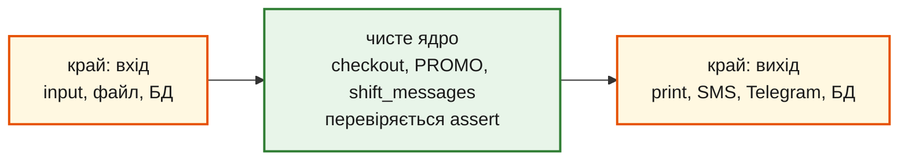

# Урок 19. Функції як об'єкти першого класу

Карантин 2020-го минув, а доставка лишилася. Система «Смачно + Таксі» з фінального проєкту модуля 1 працює щодня, і власниця щотижня просить щось нове. Нова команда `drivers`. Промокод `SUMMER10` на літо, `STUDENT15` для студентів, `NIGHT5` для нічних замовлень. Сортувати доставки то за вартістю, то за районом. Надсилати клієнтові SMS, коли водій виїхав, а тепер ще й у Telegram.

Кожне таке прохання в коді модуля 1 означає ще один `elif` в `app.py`, ще одну майже однакову функцію `apply_summer10`, ще один `if channel == "sms"`. Код росте не від нових ідей, а від копіювання.

Усе це розв'язує одна ідея, з якої починається модуль 2: **функція — це такий самий об'єкт, як число чи рядок**. Її можна покласти у змінну, у словник, передати в іншу функцію, повернути з функції. Декоратори з [уроку 10](../m1/lesson_10.md) вже спиралися на цю ідею — сьогодні розберемо її повністю.

**Що потрібно з попередніх уроків:** функції й `return` (урок 8), декоратори (урок 10), генератори (урок 11), словники й `Counter` (уроки 6, 13, 17), фінальний проєкт модуля 1 (урок 18).

**Після уроку ти зможеш:**

- зберігати функції в змінних, списках і словниках, будувати словник команд замість ланцюжка `if`;
- користуватися вбудованими функціями вищого порядку: `sorted` / `min` / `max` з `key=`, `map`, `filter`, `zip`, `any`, `all`, `functools.reduce` — і пояснювати, чому вони ліниві чи зупиняються рано;
- писати `lambda` і обирати між `map` / `filter` і comprehension;
- передавати функцію як аргумент власній функції — зворотні виклики (callback);
- створювати функції іншою функцією — фабрики й замикання, змінювати захоплену змінну через `nonlocal`; фіксувати аргументи через `functools.partial`;
- збирати конвеєр з функцій — для одного значення і лінивий для потоку даних — і пояснювати, чому його кроки мають бути чистими;
- кешувати чисті функції через `@lru_cache` і розводити успіх і помилку по двох callback-ах;
- відокремлювати чисте ядро обчислень від побічних ефектів на краях програми.

**Задача розділу.** Оформлення замовлення: промокод із реєстру, вартість доставки за районом і округлення — як конвеєр з функцій, а команди системи — як словник. Повний код — у розділі [«Практика»](#practice).

**Ноутбук заняття:** [Відкрити вправи в Colab](https://colab.research.google.com/github/NikoriakViktot/PY-Course-Victor-Nikoriak-22-09-2026/blob/main/module_2/lessons/lesson_19_functions_first_class/note_lesson_19_functions_first_class_student.ipynb){ .md-button .md-button--primary } [Переглянути розв’язки](https://github.com/NikoriakViktot/PY-Course-Victor-Nikoriak-22-09-2026/blob/main/module_2/lessons/lesson_19_functions_first_class/note_lesson_19_functions_first_class.ipynb){ .solutions-link }

## Пригадай

Дай відповідь подумки, нічого не запускаючи:

1. Що отримує на вхід і що повертає декоратор `require_role` з уроку 10?
2. Що робить `max(revenue, key=revenue.get)` з уроку 15?
3. Як `app.py` фінального проєкту вирішує, яку команду виконати?
4. Що буде, якщо вдруге пройти циклом по тому самому генератору з уроку 11?

??? success "Відповіді"

    1. Отримує функцію, повертає нову функцію-обгортку. Уже тоді функція була даними.
    2. Повертає ключ словника з найбільшим значенням: `max` викликає `revenue.get` для кожного ключа і порівнює результати.
    3. Ланцюжком `if command == "add-order" …`, `if command == "import" …` — по одному на кожну команду.
    4. Нічого: генератор вичерпаний, другий цикл не зробить жодного кроку.

## Функція — це об'єкт

Ім'я функції **без дужок** — це сама функція. **З дужками** — її виклик і результат:

```python
def fee_for(district):
    """Вартість доставки за районом."""
    return {"Поділ": 60, "Оболонь": 80}.get(district, 100)


print(type(fee_for))
print(fee_for.__name__)
print(fee_for("Поділ"))
```

```text
<class 'function'>
fee_for
60
```

`fee_for` — об'єкт типу `function` з іменем і докстрінгом, як `540` — об'єкт типу `int`. А раз це об'єкт, з ним можна робити те саме, що з будь-яким значенням. Покласти в іншу змінну:

```python
delivery_fee = fee_for
print(delivery_fee("Оболонь"), delivery_fee is fee_for)
```

```text
80 True
```

Нової функції не створилося: `delivery_fee` і `fee_for` — два ярлики одного об'єкта, як `b = a` для списку в уроці 3.

Покласти в список і пройти циклом:

```python
bills = [540.0, 320.0, 980.0]
for summary in [len, sum, max]:
    print(summary.__name__, summary(bills))
```

```text
len 3
sum 1840.0
max 980.0
```

Функції, які об'єкт мови дозволяє зберігати, передавати й повертати так само, як будь-яке значення, називають **об'єктами першого класу** (first-class objects). У Python функції саме такі.

## Вбудовані функції вищого порядку

Функцію, яка **приймає** або **повертає** іншу функцію, називають **функцією вищого порядку** (higher-order function). Ти вже користувався такою: `max(revenue, key=revenue.get)`.

У Python є готовий набір таких функцій, і з нього починається **функціональний підхід**. Замість циклу з порожнім списком, `append`, прапорцями й лічильниками ти кажеш, *що* зробити з даними: «відсортуй за ось цим», «застосуй до кожного», «залиш тих, для кого правда», «зшей два списки», «чи є хоч один». Як саме пройти по даних, вирішує Python.

| Інструмент | Що робить | Що повертає |
|---|---|---|
| `sorted` / `min` / `max` з `key=f` | порівнює елементи за `f(елемент)` | список / один елемент |
| `lambda x: вираз` | коротка функція без імені, щоб одразу її передати | функцію |
| `map(f, дані)` | обчислює `f(x)` для кожного `x` | ледачий ітератор |
| `filter(f, дані)` | лишає ті `x`, для яких `f(x)` істинне | ледачий ітератор |
| `zip(a, b, …)` | зшиває елементи з однаковим номером у кортежі | ледачий ітератор |
| `any(дані)` / `all(дані)` | чи істинний хоч один / кожен елемент | `True` / `False` |
| `functools.reduce(f, дані, поч)` | згортає дані в одне значення своєю операцією `f` | одне значення |

Спершу навчимося користуватися цими інструментами, а далі в уроці на тій самій ідеї побудуємо власні патерни: словник команд, callback, фабрику, конвеєр, декоратор — і принцип «чисте ядро, ефекти на краях».

Дані для всього розділу — доставки за зміну:

```python
from typing import NamedTuple


class Delivery(NamedTuple):
    order_id: int
    district: str
    fare: int
    driver: str


deliveries = [
    Delivery(1, "Оболонь", 230, "D-3"),
    Delivery(2, "Поділ", 180, "D-1"),
    Delivery(3, "Оболонь", 270, "D-3"),
    Delivery(4, "Печерськ", 150, "D-2"),
]

fares = [d.fare for d in deliveries]
districts = [d.district for d in deliveries]
```

### key=: за чим порівнювати

**Задача:** відсортувати доставки від дешевшої до дорожчої. `sorted` уміє порівнювати числа й рядки, але не знає, як порівнювати доставки. Дамо йому **функцію-ключ**: «для кожної доставки обчисли ось це число — і порівнюй числа». Щоб побачити, коли `sorted` її викликає, функція друкує кожен свій виклик:

```python
def by_fare(delivery):
    print(f"  key(№{delivery.order_id}) -> {delivery.fare}")
    return delivery.fare


cheap_first = sorted(deliveries, key=by_fare)
print([d.order_id for d in cheap_first])
```

```text
  key(№1) -> 230
  key(№2) -> 180
  key(№3) -> 270
  key(№4) -> 150
[4, 2, 1, 3]
```

Що видно з друку:

- `key=by_fare` — **без дужок**: передаємо саму функцію, а викликає її `sorted`;
- ключ обчислюється **один раз для кожного елемента**, потім порівнюються ключі;
- повертаються **самі доставки**, а не ключі: ключ — лише правило порівняння;
- `min` і `max` приймають той самий `key=`: `max(deliveries, key=by_fare).order_id` дає `3`; `reverse=True` перевертає порядок.

`sorted` нічого не знає про доставки. Зміни `key` — зміниться порядок, а сам `sorted` той самий.

Ключ може повертати кортеж. Кортежі порівнюються поелементно: спершу район, у межах району — вартість:

```python
def by_district_then_fare(delivery):
    return (delivery.district, delivery.fare)


for d in sorted(deliveries, key=by_district_then_fare):
    print(d.district, d.fare)
```

```text
Оболонь 230
Оболонь 270
Печерськ 150
Поділ 180
```

!!! warning "Функція, а не її результат"
    `key=by_fare` — передаємо **функцію**. `key=by_fare(d)` — передали б **результат** одного виклику, число. `sorted` спробує викликати число як функцію й впаде з `TypeError: 'int' object is not callable`. Та сама пастка — `if word.isupper:` без дужок: це завжди правда, бо функція-об'єкт істинна.

### lambda: функція в один вираз

Писати `def by_fare` заради одного `sorted` — довго. **`lambda`** створює ту саму функцію прямо там, де вона потрібна:

```python
print([d.order_id for d in sorted(deliveries, key=lambda d: d.fare)])
print(min(deliveries, key=lambda d: d.fare).driver)

fare_of = lambda delivery: delivery.fare
print(type(fare_of).__name__, fare_of.__name__)
```

```text
[4, 2, 1, 3]
D-2
function <lambda>
```

Як читати `lambda`:

```text
lambda delivery: delivery.fare
       ────┬───  ──────┬──────
       параметри  вираз — його результат повертається автоматично
```

- Це звичайний об'єкт-функція (`function`), тільки без власного імені: `__name__` у всіх — `'<lambda>'`.
- Параметрів може бути скільки завгодно, зокрема зі значеннями за замовчуванням.
- Тіло — **рівно один вираз**: без `return`, `if`-інструкції, циклу чи присвоєння. Умовний **вираз** `A if умова else B` — можна.

Різні види параметрів — кожен окремим прикладом. Імена тут лише для того, щоб показати виклик; у реальному коді таку `lambda` одразу передають у `key=` чи `map`.

**Без параметрів.** Перед двокрапкою нічого; виклик — з порожніми дужками:

```python
no_args = lambda: 60
print(no_args())
```

```text
60
```

**Кілька параметрів** — через кому, як у `def`:

```python
add = lambda a, b: a + b
print(add(2, 3))
```

```text
5
```

**Значення за замовчуванням.** Не передали `fee` — береться 60; передали за іменем — береться передане:

```python
with_fee = lambda bill, fee=60: bill + fee
print(with_fee(500), with_fee(500, fee=90))
```

```text
560 590
```

**Умовний вираз** `A if умова else B` — це вираз, тому в `lambda` можна. Інструкцію `if …:` з двокрапкою — не можна:

```python
label = lambda fare: "дорого" if fare > 200 else "ок"
print([label(fare) for fare in fares])
```

```text
['дорого', 'ок', 'дорого', 'ок']
```

!!! tip "Коли lambda, а коли def"
    `lambda` — для короткої функції, яку **одразу передаєш**: `key=`, `map`, `filter`. Якщо хочеш дати їй ім'я (`fare_of = lambda ...`), пиши `def`: буде нормальне `__name__`, докстрінг і зрозумілий traceback. Так радить і [PEP 8](https://peps.python.org/pep-0008/#programming-recommendations). `lambda fare: return fare + 20` — `SyntaxError`, бо `return` — інструкція, а не вираз.

### map: застосувати функцію до кожного

**Задача:** до кожної вартості додати сервісний збір 20 грн. Звичний цикл і `map` дають той самий результат:

```python
with_fee = []
for fare in fares:
    with_fee.append(fare + 20)
print(with_fee)

print(list(map(lambda fare: fare + 20, fares)))
```

```text
[250, 200, 290, 170]
[250, 200, 290, 170]
```

`map(функція, дані)` викликає `функція(x)` для кожного `x` і віддає результати в тому самому порядку. Порожній список, цикл і `append` пише за тебе Python.

Але `map` повертає не список, а **ледачий ітератор** — як генератор з [уроку 11](../m1/lesson_11.md). Функція викликається лише тоді, коли просять наступний елемент:

```python
def add_service(fare):
    print(f"  add_service({fare})")
    return fare + 20


lazy = map(add_service, fares)
print("map створено:", type(lazy).__name__)
print("перший:", next(lazy))
print("решта:", list(lazy))
print("ще раз:", list(lazy))
```

```text
map створено: map
  add_service(230)
перший: 250
  add_service(180)
  add_service(270)
  add_service(150)
решта: [200, 290, 170]
ще раз: []
```

Коли `map` створено, `add_service` ще жодного разу не викликалась. `next` обчислив один елемент, `list` — усі, що лишились. Удруге — порожньо: ітератор вичерпаний. Потрібен результат кілька разів — збережи список: `with_fee = list(map(...))`.

`lambda` не обов'язкова: у `map` можна передати будь-яку готову функцію — вбудовану, свою або метод класу (`str.upper` — функція, яка приймає рядок):

```python
print(list(map(str.upper, districts)))
print(list(map(len, districts)))
print(list(map(fee_for, districts)))
print(" + ".join(map(str, fares)), "=", sum(fares))
```

```text
['ОБОЛОНЬ', 'ПОДІЛ', 'ОБОЛОНЬ', 'ПЕЧЕРСЬК']
[7, 5, 7, 8]
[80, 60, 80, 100]
230 + 180 + 270 + 150 = 830
```

`map` може взяти **кілька** послідовностей — тоді функція отримує по елементу з кожної: `f(a[0], b[0])`, `f(a[1], b[1])`, … і зупиняється на **найкоротшій**:

```python
tips = [20, 0, 30]
print(list(map(lambda fare, tip: fare + tip, fares, tips)))
print(list(map(max, [1, 5, 3], [4, 2, 6])))
```

```text
[250, 180, 300]
[4, 5, 6]
```

Вартостей чотири, чайових три — четверта вартість мовчки пропала.

### filter: лишити тільки потрібні

**Задача:** відібрати доставки від 200 грн. `filter(функція, дані)` викликає функцію для кожного елемента і **лишає сам елемент**, якщо результат істинний. Таку функцію («так/ні») називають **предикатом**:

```python
print(list(filter(lambda fare: fare >= 200, fares)))

expensive = filter(lambda d: d.fare >= 200, deliveries)
print([d.order_id for d in expensive])
```

```text
[230, 270]
[1, 3]
```

Різниця з `map`: `map` **перетворює** кожен елемент (результатів стільки ж), `filter` елементи **не змінює**, а відкидає частину (результатів стільки ж або менше). Теж ледачий.

Предикат може повертати не лише `True`/`False` — `filter` дивиться на [істинність](https://docs.python.org/3/library/stdtypes.html#truth-value-testing). `filter(None, дані)` лишає просто істинні елементи:

```python
comments = ["без цибулі", "", "дзвонити в домофон", "", "   "]
print(list(filter(None, comments)))
print(list(filter(str.strip, comments)))
```

```text
['без цибулі', 'дзвонити в домофон', '   ']
['без цибулі', 'дзвонити в домофон']
```

Рядок із пробілів не порожній, отже істинний — `filter(None, …)` його лишає. `"   ".strip()` дає `""`, а це хиба — `filter(str.strip, …)` відкидає.

### map і filter чи comprehension?

Те саме вміє list comprehension з [уроку 6](../m1/lesson_06.md). «Збір 20 грн тільки для доставок від 200»:

```python
r1 = list(map(lambda fare: fare + 20, filter(lambda fare: fare >= 200, fares)))
r2 = [fare + 20 for fare in fares if fare >= 200]
print(r1, r2, r1 == r2)
```

```text
[250, 290] [250, 290] True
```

Comprehension читається зліва направо, а `map(..., filter(...))` — зсередини назовні.

| Ситуація | Пиши |
|---|---|
| вираз пишеш прямо тут (`fare + 20`, `d.fare >= 200`) | comprehension |
| функція **вже є** й має ім'я | `map(str.upper, districts)`, `filter(str.strip, comments)` |
| потрібна лінивість | `map` / `filter` або генераторний вираз `(fare + 20 for fare in fares)` |
| коротка функція для `key=` | `lambda` |

### zip: зшити кілька списків

**Задача:** номери замовлень, водії й оцінки клієнтів прийшли трьома окремими списками. `zip(a, b, …)` бере по одному елементу з кожної послідовності з **однаковим номером** і складає їх у кортеж. Теж ледачий ітератор:

```python
order_ids = [1, 2, 3, 4]
drivers = ["D-3", "D-1", "D-3", "D-2"]
ratings = [5, 4, 5]

print(list(zip(order_ids, drivers)))

for order_id, driver, rating in zip(order_ids, drivers, ratings):
    print(f"№{order_id}: {driver}, оцінка {rating}")
```

```text
[(1, 'D-3'), (2, 'D-1'), (3, 'D-3'), (4, 'D-2')]
№1: D-3, оцінка 5
№2: D-1, оцінка 4
№3: D-3, оцінка 5
```



!!! warning "zip зупиняється на найкоротшій"
    Замовлення №4 зникло без жодної помилки: оцінок лише три. Якщо довжини мусять збігатися, додай `strict=True` (Python 3.10+):

    ```python
    list(zip(order_ids, ratings, strict=True))
    ```

    ```text
    ValueError: zip() argument 2 is shorter than argument 1
    ```

Три часті прийоми з `zip`:

```python
# 1. Словник з двох списків: ключі + значення
print(dict(zip(["Поділ", "Оболонь", "Печерськ"], [60, 80, 90])))

# 2. Сусідні пари: на скільки змінилась вартість від доставки до доставки
print([b - a for a, b in zip(fares, fares[1:])])

# 3. Розпакувати назад: zip(*рядки) перетворює рядки на стовпці
rows = [(1, "D-3"), (2, "D-1"), (3, "D-3")]
ids, names = zip(*rows)
print(ids, names)
```

```text
{'Поділ': 60, 'Оболонь': 80, 'Печерськ': 90}
[-50, 90, -120]
(1, 2, 3) ('D-3', 'D-1', 'D-3')
```

У третьому прийомі `*rows` розпаковує список в окремі аргументи, як `*args` з [уроку 8](../m1/lesson_08.md): `zip((1, "D-3"), (2, "D-1"), (3, "D-3"))`. Перші елементи → `(1, 2, 3)`, другі → `('D-3', 'D-1', 'D-3')`.

### any і all: питання «так/ні» до всієї послідовності

**Задача:** чи є хоч одна доставка на Поділ? Чи всі доставки дорожчі за 100 грн?

- `any(дані)` — `True`, якщо **хоч один** елемент істинний;
- `all(дані)` — `True`, якщо **кожен** елемент істинний.

Усередину зазвичай пишуть генераторний вираз — без зайвих дужок:

```python
print(any(d.district == "Поділ" for d in deliveries))
print(all(d.fare > 100 for d in deliveries))
print(all(d.fare > 200 for d in deliveries))
```

```text
True
True
False
```

`any` — це згорнутий цикл «шукай, доки не знайдеш»:

```python
def has_district(deliveries, district):
    for d in deliveries:
        if d.district == district:
            return True
    return False
```

І, як цей цикл, `any` та `all` зупиняються, щойно відповідь відома, — **скорочене обчислення** (short-circuit):

```python
def is_expensive(fare):
    print(f"  перевіряю {fare}")
    return fare > 200


print("any:", any(is_expensive(f) for f in fares))
print("all:", all(is_expensive(f) for f in fares))
print("any зі списком:", any([is_expensive(f) for f in fares]))
```

```text
  перевіряю 230
any: True
  перевіряю 230
  перевіряю 180
all: False
  перевіряю 230
  перевіряю 180
  перевіряю 270
  перевіряю 150
any зі списком: True
```

`any` перевірив одну вартість: 230 > 200 — відповідь «так» уже відома. `all` — дві: 180 не більше за 200. А з квадратними дужками спершу будується **увесь** список, і скорочення втрачено — пиши без `[ ]`.

!!! warning "Порожні дані: all([]) — це True"
    ```python
    print(any([]), all([]))

    shift = []
    print(all(d.fare > 0 for d in shift))
    print(bool(shift) and all(d.fare > 0 for d in shift))
    ```

    ```text
    False True
    True
    False
    ```

    `all([])` — немає жодного **хибного** елемента, тому «всі» формально правда. Перевірка `all(...)` на порожніх даних завжди проходить. Якщо порожні дані — теж помилка, перевір це окремо: `shift and all(...)`.

### reduce: згорнути послідовність в одне значення

`sum`, `max`, `any`, `all` — **згортки** (reductions): з багатьох значень роблять одне. Кожна знає лише свою операцію. Загальну згортку для **будь-якої** операції дає `functools.reduce(функція, дані, початкове)`. Функція отримує два аргументи — **накопичене** значення й **наступний** елемент — і повертає нове накопичене:

```python
from functools import reduce


def add_logged(total, fare):
    print(f"  {total} + {fare} = {total + fare}")
    return total + fare


print(reduce(add_logged, fares))
```

```text
  230 + 180 = 410
  410 + 270 = 680
  680 + 150 = 830
830
```

```text
reduce(f, [a, b, c, d])  ==  f(f(f(a, b), c), d)
```

Без початкового значення накопиченим стає перший елемент. З порожніми даними це ламається:

```python
print(reduce(lambda total, fare: total + fare, [], 0))
reduce(lambda total, fare: total + fare, [])
```

```text
0
TypeError: reduce() of empty iterable with no initial value
```

!!! tip "Коли reduce"
    Для суми, максимуму, «хоч один», «всі» є готові `sum`, `max`, `any`, `all` — вони читаються краще. `reduce` — коли операція своя: наприклад, прогнати ціну крізь список функцій-кроків (розділ [«Конвеєр»](#pipeline)). Якщо дані можуть бути порожні — **завжди** давай початкове значення.

**Перевір себе.** Запиши кожен пункт одним рядком без циклу з `append`: список вартостей зі збором 20 грн; номери доставок на Оболонь; рядки `"№1 D-3"`, `"№2 D-1"`, …; чи є доставка дешевша за 160 грн; водій найдорожчої доставки.

??? success "Відповідь"

    ```python
    list(map(lambda fare: fare + 20, fares))                  # [250, 200, 290, 170]
    [d.order_id for d in deliveries if d.district == "Оболонь"]  # [1, 3]
    [f"№{i} {driver}" for i, driver in zip(order_ids, drivers)]  # ['№1 D-3', ...]
    any(fare < 160 for fare in fares)                          # True
    max(deliveries, key=lambda d: d.fare).driver               # 'D-3'
    ```

## Патерни функціональної архітектури

Досі функцію приймали вбудовані `sorted`, `map`, `filter`, `reduce`. Далі — **власні** функції, що зберігають, приймають і повертають функції. Разом вони дають **функціональну архітектуру**: програма — це композиція функцій, які **перетворюють дані**, а не постійно змінюють спільний стан.

| Патерн | Проблема сервісу | Ідея |
|---|---|---|
| Словник команд | `run` росте ланцюжком `if` | функції — значення словника |
| Callback | `dispatch` не має знати, SMS чи Telegram | «коли» вирішує функція, «що» — той, хто викликає |
| Фабрика + замикання | функції-близнюки `apply_summer10`, `apply_student15` | функція створює функцію, а та пам'ятає параметри |
| Конвеєр | ціна проходить кілька кроків | список функцій, вихід кроку — вхід наступного |
| `partial`, каррінг | фабрика заради одного зафіксованого аргументу | `partial(discount, 10)` — готова фабрика |
| Лінивий конвеєр | мільйон доставок не влазить у списки | генератори, `map`, `filter` — по одному елементу |
| Декоратор | додати лог чи перевірку, не змінюючи функцію | функція-обгортка з фабрики |
| Мемоїзація | повільний сервіс карт питають про той самий район | `@lru_cache` пам'ятає результати чистої функції |
| `on_success` / `on_error` | обробка помилок дублюється в кожному місці виклику | два callback-и: канал успіху й канал помилки |
| Чисте ядро | розрахунки змішані з `print` і SMS | обчислення — чисті функції, ефекти — на краях |

## Словник команд замість ланцюжка if

У фінальному проєкті `app.py` вибирав команду ланцюжком `if`. Кожна нова команда — ще одна гілка, і функція `run` росте без кінця. Але якщо функції — дані, то «яку функцію викликати для якої команди» — це просто **словник**:

```python
def cmd_report(orders):
    return f"Замовлень: {len(orders)}, виторг: {sum(orders):.2f} грн"


def cmd_top(orders):
    return f"Найбільший чек: {max(orders):.2f} грн"


COMMANDS = {
    "report": cmd_report,
    "top": cmd_top,
}


def run(command, orders):
    handler = COMMANDS.get(command)
    if handler is None:
        return f"Помилка: невідома команда {command}. Є: {', '.join(COMMANDS)}"
    return handler(orders)


orders = [540.0, 320.0, 980.0]
print(run("report", orders))
print(run("top", orders))
print(run("fly", orders))
```

```text
Замовлень: 3, виторг: 1840.00 грн
Найбільший чек: 980.00 грн
Помилка: невідома команда fly. Є: report, top
```

Нова команда — нова функція і **один рядок** у словнику. `run` не змінюється. Такий словник називають **таблицею диспетчеризації** (dispatch table). Бонус: список доступних команд для підказки береться з того самого словника й ніколи не застаріє.

## Callback: що робити, вирішує той, хто викликає

`sorted` і `map` отримують функцію і викликають її самі. Так само може робити й наша функція.

Водій виїхав — клієнта треба повідомити. Як саме — SMS, Telegram чи просто запис у журнал — функція доставки знати не повинна. Вона отримує функцію повідомлення аргументом і **викликає її у потрібний момент**. Таку функцію називають **зворотним викликом** (callback):

```python
def dispatch(delivery, notify):
    """Відправляє водія і повідомляє клієнта через notify(текст)."""
    notify(f"Замовлення №{delivery.order_id}: водій {delivery.driver} виїхав, {delivery.fare} грн")


def notify_sms(text):
    print("SMS:", text)


def notify_telegram(text):
    print("Telegram:", text)


dispatch(deliveries[0], notify_sms)
dispatch(deliveries[1], notify_telegram)
```

```text
SMS: Замовлення №1: водій D-3 виїхав, 230 грн
Telegram: Замовлення №2: водій D-1 виїхав, 180 грн
```

Новий канал — нова функція, `dispatch` не змінюється. А в тестах замість справжнього SMS можна передати `sent.append` і перевірити, що саме пішло б клієнтові:

```python
sent = []
dispatch(deliveries[2], sent.append)
print(sent)
```

```text
['Замовлення №3: водій D-3 виїхав, 270 грн']
```

`sent.append` — теж функція: метод конкретного списку. Передаємо його без дужок, і `dispatch` викликає його як будь-який інший `notify`.

## Функція, що створює функції

Промокоди. Наївно — функція на кожен:

```python
def apply_summer10(bill):
    return bill * 0.9


def apply_student15(bill):
    return bill * 0.85
```

Функції-близнюки відрізняються одним числом. Можна додати параметр — `apply_discount(bill, percent)`, — але тоді кожне місце виклику має знати відсоток, а реєстр «код → знижка» знову стає ланцюжком `if`. Краще **функція, яка створює** функцію-знижку з потрібним відсотком:

```python
def make_discount(percent):
    """Фабрика: повертає функцію, що знижує чек на percent відсотків."""
    def apply(bill):
        return round(bill * (100 - percent) / 100, 2)
    return apply


summer10 = make_discount(10)
student15 = make_discount(15)
print(summer10(540.0), student15(540.0))
print(summer10.__name__)
```

```text
486.0 459.0
apply
```

`make_discount` — **фабрика функцій**: кожен виклик створює нову функцію `apply`. І кожна `apply` **пам'ятає** свій `percent`, хоча `make_discount` давно завершилась. Функцію разом із запам'ятованими змінними зовнішньої функції називають **замиканням** (closure).

Тепер реєстр промокодів — словник, як таблиця команд:

```python
PROMO = {
    "SUMMER10": make_discount(10),
    "STUDENT15": make_discount(15),
    "NIGHT5": make_discount(5),
}

print(PROMO["NIGHT5"](980.0))
```

```text
931.0
```

### Де функція шукає змінні: LEGB

Коли `apply` бачить `percent`, Python шукає ім'я в чотирьох місцях по черзі — правило **LEGB**:



`percent` знайшовся на рівні **E** — у функції, що оточує `apply`. Саме тому `apply` бачить його й після того, як `make_discount` повернула результат.

### nonlocal: змінити захоплену змінну

Читати змінну з оточення можна вільно. А **змінити**? Лічильник номерів замовлень:

```python
def make_counter_broken():
    count = 0

    def next_id():
        count += 1
        return count

    return next_id


try:
    make_counter_broken()()
except UnboundLocalError as error:
    print(type(error).__name__)
```

```text
UnboundLocalError
```

Присвоєння `count += 1` робить `count` **локальною** змінною `next_id`, і Python не шукає її в оточенні. А локальна `count` ще не має значення. `nonlocal` каже: це змінна з оточуючої функції, змінюй її там:

```python
def make_counter(start=0):
    count = start

    def next_id():
        nonlocal count
        count += 1
        return count

    return next_id


new_order_id = make_counter()
print(new_order_id(), new_order_id(), new_order_id())

other = make_counter(100)
print(other(), new_order_id())
```

```text
1 2 3
101 4
```

Кожен виклик `make_counter` створює **свій** лічильник: `other` і `new_order_id` не заважають один одному. Функція, що носить із собою власний стан, — це вже майже об'єкт. Саме туди приведе урок 20 про класи.

!!! warning "Пастка: функції в циклі"
    ```python
    fees = [lambda bill: bill + fee for fee in (60, 80, 100)]
    print([f(500) for f in fees])
    ```

    ```text
    [600, 600, 600]
    ```

    Усі три функції бачать **ту саму** змінну `fee` — і вона вже дорівнює 100, коли функції викликають. Замикання пам'ятає змінну, а не її значення в момент створення. Рішення — фабрика: `[make_fee(fee) for fee in (60, 80, 100)]`, де кожен виклик `make_fee` має свій `fee`.

### partial: фабрика, яку не треба писати

Часто загальна функція вже є, а потрібна її «налаштована» версія з частиною зафіксованих аргументів. Це **часткове застосування** (partial application). `functools.partial(функція, аргументи…)` повертає нову функцію, у якій ці аргументи вже підставлені:

```python
from functools import partial


def discount(percent, bill):
    return round(bill * (100 - percent) / 100, 2)


summer10_p = partial(discount, 10)            # percent = 10 зафіксовано
print(summer10_p(540.0), make_discount(10)(540.0))

expensive_first = partial(sorted, key=lambda d: d.fare, reverse=True)
print([d.order_id for d in expensive_first(deliveries)])
```

```text
486.0 486.0
[3, 1, 2, 4]
```

Позиційні аргументи `partial` підставляє **зліва**: `partial(discount, 10)(540.0)` — це `discount(10, 540.0)`. Звідси пастка:

```python
print(partial(discount, 540.0)(10))
print(partial(discount, bill=540.0)(10))
```

```text
-44.0
486.0
```

У першому рядку `540.0` став `percent`, і знижка вийшла 540 %. Щоб зафіксувати не перший параметр, передай його за іменем.

**Каррінг** (currying) — запис функції кількох аргументів як ланцюжка функцій **одного** аргументу: `make_discount(10)(540.0)`. Наша фабрика — це вже каррінг вручну; Python не робить його автоматично, на практиці вистачає `partial`.

!!! tip "partial чи фабрика"
    Загальна функція вже є, треба лише зафіксувати аргументи — `partial`. Потрібна логіка під час створення (перевірка району, як у `make_fee` з практики) чи стан (`nonlocal`) — фабрика.

## Конвеєр з функцій { #pipeline }

Ціна замовлення проходить кілька кроків: знижка за промокодом, вартість доставки за районом, округлення до гривні. Кожен крок — функція «число → число». А раз функції — дані, **список кроків** — теж дані:

```python
def add_fee(bill):
    return bill + 80


def to_uah(bill):
    return round(bill)


def run_pipeline(value, steps):
    for step in steps:
        value = step(value)
    return value


checkout = [PROMO["SUMMER10"], add_fee, to_uah]
print(run_pipeline(540.0, checkout))
print(run_pipeline(540.0, [add_fee, PROMO["SUMMER10"], to_uah]))
```

```text
566
558
```

Той самий чек, ті самі кроки — різний результат. У другому варіанті знижку отримала й доставка. **Порядок кроків — це бізнес-правило**, і тепер воно записане в одному місці: у списку `checkout`, а не розмазане по коду.

`run_pipeline` — це згортка: накопичене значення — ціна, елементи — кроки, операція — «застосуй крок». Той самий результат одним рядком: `reduce(lambda value, step: step(value), checkout, 540.0)` → `566`.



### Лінивий конвеєр: дані йдуть по одному

`run_pipeline` проводить через кроки **одне** значення. А якщо даних мільйон — доставки з файлу чи БД? Збирати їх у список, потім ще один список після фільтра, потім ще один після `map` — дорого. `map`, `filter` і генератори ліниві, тож з них складається **конвеєр для потоку**. Обгорнемо кроки так, щоб вони друкували свої виклики:

```python
def trace(name, fn):
    def wrapped(x):
        print(f"  {name}({x})")
        return fn(x)
    return wrapped


stream = iter(fares)                     # як рядки файлу: приходять по одному
expensive = filter(trace("filter", lambda fare: fare >= 200), stream)
with_fee = map(trace("map", lambda fare: fare + 20), expensive)
print("конвеєр зібрано — ще нічого не пораховано")

for total in with_fee:
    print("отримав", total)
```

```text
конвеєр зібрано — ще нічого не пораховано
  filter(230)
  map(230)
отримав 250
  filter(180)
  filter(270)
  map(270)
отримав 290
  filter(150)
```

Кроки **чергуються**: кожен елемент проходить увесь конвеєр, і лише тоді береться наступний. Проміжних списків немає. На великих даних різниця відчутна:

```python
import sys
from itertools import islice

big = range(1_000_000)
print("список:", sys.getsizeof([x * 2 for x in big]), "байт")
print("map:   ", sys.getsizeof(map(lambda x: x * 2, big)), "байт")


def delivery_stream(n):
    """Генератор: мільйон доставок, але в пам'яті — завжди одна."""
    for i in range(n):
        yield Delivery(i, "Поділ", 100 + i % 300, "D-1")


top3 = islice(filter(lambda d: d.fare >= 390, delivery_stream(1_000_000)), 3)
print([d.order_id for d in top3])
```

```text
список: 8448728 байт
map:    48 байт
[290, 291, 292]
```

Список займає мегабайти, `map` — кілька десятків байтів: він зберігає не результати, а «рецепт». `islice(дані, 3)` бере перші три елементи й зупиняє весь конвеєр — з мільйона доставок генератор створив лише 293. Збирай конвеєр з генераторів, `map`, `filter`, `islice` і перетворюй у список лише в самому кінці — або взагалі ні: `sum`, `for`, запис у файл.

### Кроки мають бути чистими

Конвеєр працює, лише якщо кожен крок **чистий** (урок 8): отримує значення, повертає нове й нічого не змінює навколо. Крок, який змінює вхідний список, ламає все, що йде після нього — і все, що використовує той самий список:

```python
def add_packaging_bad(items):
    items.append("пакет")
    return items


def add_packaging(items):
    return items + ["пакет"]


cart = ["борщ", "вареники"]
print(add_packaging(cart), cart)
print(add_packaging_bad(cart), cart)
```

```text
['борщ', 'вареники', 'пакет'] ['борщ', 'вареники']
['борщ', 'вареники', 'пакет'] ['борщ', 'вареники', 'пакет']
```

Чиста версія повернула новий список і не зачепила `cart`. Нечиста змінила кошик клієнта: після другого виклику «пакет» опиниться там двічі.

**Чиста функція** (pure function) — це дві умови разом:

1. **Той самий вхід → той самий результат.** Результат залежить лише від аргументів, а не від часу, глобальних змінних чи файлів.
2. **Немає побічних ефектів** (side effects): не змінює аргументи й глобальні змінні, не друкує, не пише у файл чи БД, не надсилає SMS.

Які з цих функцій чисті?

```python
from datetime import datetime

shift_total = 0


def add_to_shift(fare):                      # змінює глобальну змінну
    global shift_total
    shift_total += fare
    return shift_total


def fee_logged(district):                    # друкує — це теж ефект
    print("  рахую доставку:", district)
    return fee_for(district)


def night_fee(district):                     # прихований вхід — годинник
    return fee_for(district) * (2 if datetime.now().hour >= 22 else 1)


def surge_fee(district, hour):               # усе, від чого залежить, — в аргументах
    return fee_for(district) * (2 if hour >= 22 else 1)


print(add_to_shift(230), add_to_shift(230))
print(surge_fee("Поділ", 23), surge_fee("Поділ", 23), surge_fee("Поділ", 12))
```

```text
230 460
120 120 60
```

Чиста лише `surge_fee`. `add_to_shift` з тим самим аргументом повертає різне. `fee_logged` рахує правильно, але сто викликів — сто рядків у консолі. `night_fee` залежить від того, **коли** її викликали: тест, що пройшов удень, упаде вночі. `surge_fee` — той самий код, але годину передають аргументом. Прийом універсальний: **прихований вхід зроби аргументом**.

**Незмінність** (immutability) — найпростіший спосіб не зламати дані: взяти тип, який змінити не можна. `Delivery` — `NamedTuple`, тобто кортеж. Щоб «змінити» вартість, створюємо нову доставку, а стара лишається як була:

```python
d = deliveries[0]
discounted = d._replace(fare=d.fare - 30)
print(d.fare, discounted.fare)
d.fare = 0
```

```text
230 200
AttributeError: can't set attribute
```

Навіщо все це: **передбачуваність** (результат видно з аргументів), **тести** (`assert f(x) == y` без підготовки стану), **порядок і повтор** (чисті кроки можна переставляти, кешувати), **паралельність** (немає спільного стану — нема кому заважати).

### Декоратор — це теж фабрика

Декоратор з уроку 10 тепер розкладається на знайомі частини: функція, яка **приймає** функцію (вищого порядку), **створює** нову (фабрика) і **пам'ятає** оригінал (замикання):

```python
from functools import wraps


def log_calls(func):
    @wraps(func)
    def wrapper(*args):
        result = func(*args)
        print(f"{func.__name__}{args} -> {result}")
        return result
    return wrapper


@log_calls
def add_fee_logged(bill):
    return bill + 80


add_fee_logged(486.0)
```

```text
add_fee_logged(486.0,) -> 566.0
```

Декоратор можна застосувати й без `@` — як звичайну фабрику, наприклад до всіх кроків конвеєра: `logged = [log_calls(step) for step in checkout]`. Самі кроки лишаються чистими, лог додано **ззовні**.

### Мемоїзація: декоратор, що пам'ятає результати

Чиста функція для тих самих аргументів **завжди** повертає те саме — отже, результат можна запам'ятати й удруге не рахувати. Це **мемоїзація** (memoization); готовий декоратор — `functools.lru_cache`. Нехай час доїзду рахує повільний сервіс карт, а `print` показує, коли функція **справді** працює:

```python
from functools import lru_cache


@lru_cache(maxsize=128)
def route_minutes(district):
    """Нібито повільний запит до сервісу карт."""
    print(f"  рахую маршрут до {district}...")
    return {"Поділ": 15, "Оболонь": 25, "Печерськ": 20}.get(district, 40)


for d in deliveries:
    print(f"№{d.order_id} {d.district}: {route_minutes(d.district)} хв")
print(route_minutes.cache_info())
```

```text
  рахую маршрут до Оболонь...
№1 Оболонь: 25 хв
  рахую маршрут до Поділ...
№2 Поділ: 15 хв
№3 Оболонь: 25 хв
  рахую маршрут до Печерськ...
№4 Печерськ: 20 хв
CacheInfo(hits=1, misses=3, maxsize=128, currsize=3)
```

Для доставки №3 Оболонь уже в кеші: функція не викликалась (`hits=1`). `maxsize=128` — скільки результатів пам'ятати; найдавніше використані витісняються (least recently used). Без обмеження — `@functools.cache`.

!!! warning "Кешувати можна лише чисті функції"
    При влучанні в кеш тіло функції **не виконується** — навіть `print` вище. `night_fee` з `@lru_cache` назавжди запам'ятає денний тариф, а функція, що надсилає SMS, надішле його лише раз. І аргументи мають бути **хешованими**, як ключі словника: `route_minutes(["Поділ"])` → `TypeError: unhashable type: 'list'`.

## Чисте ядро, ефекти на краях

Головний принцип функціональної архітектури — **відокремити обчислення від побічних ефектів**:

- **чисте ядро** (pure core) — уся бізнес-логіка: чисті функції, що отримують дані й повертають дані;
- **ефекти на краях** (side effects at the edges) — введення, файли, БД, `print`, SMS: маленькі функції на межі програми, які лише передають дані з ядра у світ.



**Задача:** наприкінці зміни кожен водій отримує повідомлення з виторгом. «В лоб» підрахунок і надсилання змішані в одній функції:

```python
from collections import Counter


def close_shift_mixed(deliveries):
    totals = Counter()
    for d in deliveries:
        totals[d.driver] += d.fare
    for driver in sorted(totals):
        print(f"SMS {driver}: за зміну {totals[driver]} грн")
```

Перевірити суми можна, лише перехопивши `print`; для Telegram доведеться скопіювати підрахунок. Розріжемо: **ядро** рахує й повертає тексти, **край** лише надсилає — через callback:

```python
def shift_messages(deliveries):
    """Чисте ядро: доставки -> тексти повідомлень. Нічого не надсилає."""
    totals = Counter()
    for d in deliveries:
        totals[d.driver] += d.fare
    return [f"{driver}: за зміну {totals[driver]} грн" for driver in sorted(totals)]


def close_shift(deliveries, notify):
    """Край: тут і тільки тут побічний ефект."""
    for text in shift_messages(deliveries):
        notify(text)


assert shift_messages(deliveries) == [
    "D-1: за зміну 180 грн", "D-2: за зміну 150 грн", "D-3: за зміну 500 грн",
]
assert shift_messages([]) == []
close_shift(deliveries, notify_sms)
```

```text
SMS: D-1: за зміну 180 грн
SMS: D-2: за зміну 150 грн
SMS: D-3: за зміну 500 грн
```

`shift_messages` змінює `totals`, але це її **власна** локальна змінна, створена в цьому виклику, — ззовні цього не видно, тож функція чиста. Ядро тестується одним `assert`, а канал виводу міняється аргументом. Так побудований і `checkout` з практики нижче: він **повертає** ціну, а не друкує її.

Поглиблення: [Pure Functions & Immutability](https://github.com/NikoriakViktot/PY-Course-Victor-Nikoriak-22-09-2026/blob/main/module_2/lessons/lesson_19_functions_first_class/pattern_05_pure_functions.md) — від проблеми до «pure core» покроково.

## Практика { #practice }

### Розібраний приклад: оформлення замовлення

Зберемо все разом: реєстр промокодів, вартість доставки за районом, конвеєр і команди.

```python linenums="1" hl_lines="2 6 7 8 12 13 22 25 31 32 33"
FEES = {"Поділ": 60, "Оболонь": 80, "Печерськ": 90}


def make_fee(district):
    """Фабрика: крок конвеєра, що додає вартість доставки в район."""
    if district not in FEES:
        raise ValueError(f"не доставляємо в район {district}")
    fee = FEES[district]

    def add(bill):
        return bill + fee
    return add


def checkout_steps(promo_code, district):
    """Кроки для замовлення: знижка (якщо є промокод) → доставка → гривні."""
    steps = []
    if promo_code:
        if promo_code not in PROMO:
            raise ValueError(f"промокод {promo_code} не дійсний")
        steps.append(PROMO[promo_code])
    steps.append(make_fee(district))
    steps.append(to_uah)
    return steps


def checkout(bill, promo_code, district):
    return run_pipeline(bill, checkout_steps(promo_code, district))


CHECKOUT_CASES = [(540.0, "SUMMER10", "Оболонь"), (320.0, None, "Поділ"),
                  (980.0, "STUDENT15", "Печерськ"), (540.0, "FREE100", "Поділ"),
                  (540.0, None, "Троєщина")]

for bill, code, district in CHECKOUT_CASES:
    try:
        print(bill, code, district, "->", checkout(bill, code, district))
    except ValueError as error:
        print(bill, code, district, "-> помилка:", error)
```

```text
540.0 SUMMER10 Оболонь -> 566
320.0 None Поділ -> 380
980.0 STUDENT15 Печерськ -> 923
540.0 FREE100 Поділ -> помилка: промокод FREE100 не дійсний
540.0 None Троєщина -> помилка: не доставляємо в район Троєщина
```

Що відбувається в ключових рядках:

- **рядок 2** — вартість доставки — дані, а не `if` для кожного району;
- **рядки 6–8, 12–13** — фабрика `make_fee` перевіряє район один раз, а функція `add` пам'ятає `fee` через замикання;
- **рядки 22, 25** — список кроків збирається з функцій: промокод береться з реєстру `PROMO`, доставка — з фабрики, округлення — готова `to_uah`;
- **рядки 31–33** — `checkout` не знає, які саме кроки виконує. Новий крок — рядок у `checkout_steps`, а не переписаний `checkout`;
- помилки — `ValueError` з поясненням, як у модулі 1: промокод і район перевіряються **до** обчислень.

### Два канали: on_success і on_error

У циклі вище `try/except` і `print` живуть у коді, що викликає `checkout`, — і кожне нове місце виклику (бот, сайт, звіт) повторить цю обробку. Передамо **дві** функції: для успіху й для помилки. Обчислення лише вирішує, **в який канал** віддати результат. Це callback, тільки на дві колії; підхід називають railway-oriented programming:

```python
def place_order(bill, promo_code, district, on_success, on_error):
    """Рахує замовлення і віддає результат в один із двох каналів."""
    try:
        total = checkout(bill, promo_code, district)
    except ValueError as error:
        on_error(f"{district}, {promo_code}: {error}")
    else:
        on_success(total)


accepted, rejected = [], []
for bill, code, district in CHECKOUT_CASES:
    place_order(bill, code, district, accepted.append, rejected.append)
print("прийнято:", accepted)
print("відхилено:", rejected)

place_order(540.0, None, "Троєщина",
            on_success=lambda total: print("✅ до сплати", total),
            on_error=lambda message: print("❌", message))
```

```text
прийнято: [566, 380, 923]
відхилено: ['Поділ, FREE100: промокод FREE100 не дійсний', 'Троєщина, None: не доставляємо в район Троєщина']
❌ Троєщина, None: не доставляємо в район Троєщина
```

!!! warning "Лови лише очікувані помилки"
    `except ValueError`, а не `except Exception`. `ValueError` — «замовлення некоректне», його місце — канал `on_error`. А `TypeError` чи `NameError` — баг у коді: якби `place_order` ловив усе, баг тихо став би «відхиленим замовленням».

### Зміни приклад: команда drivers

Додай у таблицю `COMMANDS` з розділу про словник команд нову команду `drivers`. Вона отримує список доставок і повертає рядок з водіями за виторгом, від більшого до меншого:

```text
D-3 500, D-1 180, D-2 150
```

**Критерії перевірки:**

- `run` не змінюється — лише нова функція і рядок у `COMMANDS`;
- виторг рахується за один прохід (`Counter` або словник з `get`);
- сортування — `sorted(..., key=…, reverse=True)` з `lambda` або `dict.get` як ключем;
- `run("fly", deliveries)` у підказці показує й нову команду.

??? tip "Підказка"
    `Counter` уміє додавати: `totals[d.driver] += d.fare`. Потім `sorted(totals, key=totals.get, reverse=True)` дає водіїв у потрібному порядку, а `", ".join(f"{name} {totals[name]}" for name in …)` — рядок.

### Спробуй самостійно: промокод з обмеженням

Маркетинг роздає **обмежені** промокоди: `LUCKY20` діє лише для перших трьох замовлень. Напиши фабрику `make_limited_discount(percent, uses)`:

- повертає функцію `apply(bill)` зі знижкою `percent`, як `make_discount`;
- кожен виклик зменшує кількість використань, що лишилися;
- коли використань не лишилося — `apply` піднімає `ValueError("промокод вичерпано")`.

```text
lucky = make_limited_discount(20, 3)
lucky(500.0)  →  400.0
lucky(500.0)  →  400.0
lucky(250.0)  →  200.0
lucky(500.0)  →  ValueError: промокод вичерпано
```

**Правила:**

- лічильник живе в замиканні, `nonlocal` — без глобальних змінних;
- два промокоди, створені окремими викликами фабрики, мають незалежні лічильники;
- `apply` можна покласти в `PROMO` і використати в `checkout` без змін.

### Знайди помилку

Кожен фрагмент — справжня помилка початківця. Що піде не так?

```python
# 1
sum = sum([540.0, 320.0])
total_fares = sum([230, 180])

# 2
code = "summer10"
if code.isupper:
    print("код у верхньому регістрі")

# 3
districts = ["Оболонь", "Поділ", "Печерськ"]
print(sorted(districts, key=len(districts)))
```

??? success "Відповіді"

    1. Перший рядок **перезаписав** вбудовану функцію `sum` числом `860.0`. Другий рядок пробує викликати число: `TypeError: 'float' object is not callable`. Не називай змінні іменами вбудованих функцій: `total_bills = sum(...)`.
    2. `code.isupper` без дужок — сама функція, а функція завжди істинна. Умова виконається для будь-якого рядка. Потрібен виклик: `code.isupper()`.
    3. `len(districts)` — це `3`, число, а не функція. `sorted` спробує викликати `3(...)` і впаде з `TypeError`. Треба передати саму функцію: `key=len`.

## Підсумок

| Поняття | Що запам'ятати |
|---|---|
| Функція — об'єкт | `f` — функція, `f()` — її результат; можна в змінну, список, словник |
| Словник команд | `COMMANDS[name](...)` замість ланцюжка `if`; нова команда — рядок |
| Функція вищого порядку | приймає чи повертає функцію: `sorted(key=…)`, `map`, декоратори |
| `key=` | функція одного аргументу; повертаються самі елементи, не ключі |
| `lambda` | функція з одного виразу, щоб одразу передати; з іменем — пиши `def` |
| `map`, `filter` | перетворити кожен / лишити частину; ліниві, одноразові; часто — comprehension |
| `zip` | зшиває за номером, зупиняється на найкоротшій; `strict=True` |
| `any`, `all` | хоч один / кожен; зупиняються рано; `all([])` — `True` |
| Callback | функція-аргумент, яку викликають у потрібний момент |
| Фабрика й замикання | функція створює функцію, а та пам'ятає змінні оточення |
| LEGB, `nonlocal` | порядок пошуку імен; `nonlocal`, щоб змінити змінну оточення |
| `reduce` | своя згортка: `f(накопичене, елемент)`; початкове — для порожніх даних |
| Конвеєр | список функцій-кроків; порядок — правило; кроки — чисті |
| Чиста функція | той самий вхід → той самий результат; без побічних ефектів |
| Чисте ядро | обчислення — чисті функції; `print`, SMS, БД — на краях |
| `partial` | фіксує аргументи зліва (інші — за іменем); готова фабрика |
| Лінивий конвеєр | `map` / `filter` / генератори — по одному елементу, без проміжних списків; `islice` |
| `@lru_cache` | пам'ятає результати; лише чисті функції з хешованими аргументами |
| `on_success` / `on_error` | два канали замість `try/except` у кожному місці виклику |

### Самоперевірка

1. Чим `fee_for` відрізняється від `fee_for("Поділ")`?
2. Чому `list(m)` для того самого `map` удруге дає `[]`?
3. Скільки пар дасть `zip([1, 2, 3], ["a", "b"])` і як не пропустити різницю довжин?
4. Чому `any(f(x) for x in xs)` може викликати `f` один раз, а `any([f(x) for x in xs])` — завжди для кожного?
5. Що дає словник команд порівняно з ланцюжком `if`?
6. Навіщо `dispatch` приймає `notify` аргументом, а не викликає SMS сама?
7. Чому `summer10` пам'ятає `percent = 10`, хоча `make_discount` вже завершилась?
8. Чому без `nonlocal` лічильник падає з `UnboundLocalError`?
9. Чому всі функції з `[lambda bill: bill + fee for fee in (60, 80, 100)]` додають 100?
10. Чому порядок кроків у конвеєрі змінює ціну? Що буде, якщо крок змінює вхідний список?
11. Назви дві умови чистої функції. Чим `night_fee` нечиста і як її виправити?
12. Що таке «чисте ядро, ефекти на краях»? Як розрізати функцію, що і рахує, і друкує?
13. Що поверне `partial(discount, 540.0)(10)` і чому? Як зафіксувати `bill`?
14. Чому лінивий конвеєр не створює проміжних списків? Що робить `islice`?
15. Чому `@lru_cache` не можна ставити на `night_fee` чи на функцію, що надсилає SMS?
16. Навіщо `place_order` два callback-и і чому він ловить лише `ValueError`?

??? success "Відповіді"

    1. `fee_for` — сама функція, об'єкт. `fee_for("Поділ")` — результат виклику, число `60`.
    2. `map` — ледачий ітератор: перший `list` його вичерпав. Збережи результат у список.
    3. Дві: `zip` зупиняється на найкоротшій. `zip(..., strict=True)` підніме `ValueError`.
    4. Генераторний вираз дає значення по одному, і `any` зупиняється на першому істинному. Квадратні дужки спершу будують увесь список.
    5. Нова команда — функція й один рядок у словнику, `run` не змінюється; перелік команд для підказки береться з того самого словника.
    6. Щоб спосіб повідомлення обирав той, хто викликає: SMS, Telegram, журнал чи список у тесті. `dispatch` від цього не змінюється.
    7. `apply` — замикання: разом із функцією зберігаються змінні оточуючої функції, які вона використовує.
    8. Присвоєння `count += 1` робить `count` локальною змінною `next_id`, а локальна ще не має значення. `nonlocal` каже шукати й змінювати її в оточуючій функції.
    9. Замикання пам'ятає **змінну** `fee`, а не її значення в момент створення. Коли функції викликають, цикл уже завершився, і `fee` дорівнює 100.
    10. Кожен крок працює з результатом попереднього: знижка до доставки і після — різні суми. Крок, що змінює вхідний список, змінює дані для всіх наступних кроків і для всього коду, який тримає той самий список.
    11. Той самий вхід → той самий результат, і жодних побічних ефектів. `night_fee` читає годинник — прихований вхід; годину треба передати аргументом, як у `surge_fee`.
    12. Обчислення — чисті функції, що повертають дані; `print`, SMS, БД — у маленьких функціях на краю. Підрахунок — у функцію, що повертає тексти; надсилання — у функцію, що отримує `notify`.
    13. `-44.0`: `540.0` підставився першим, як `percent`. Треба `partial(discount, bill=540.0)`.
    14. Кожен елемент проходить усі кроки, лише тоді береться наступний. `islice` бере перші n і зупиняє весь конвеєр.
    15. Кеш не викликає функцію вдруге: прихований вхід (годинник) більше не читається, а побічний ефект (SMS) не повторюється.
    16. Обчислення не знає, що робити з результатом — це вирішує той, хто викликає. `ValueError` — некоректне замовлення, інші помилки — баги, їх не можна ховати.

### Що далі

- Ноутбук заняття: [Відкрити вправи в Colab](https://colab.research.google.com/github/NikoriakViktot/PY-Course-Victor-Nikoriak-22-09-2026/blob/main/module_2/lessons/lesson_19_functions_first_class/note_lesson_19_functions_first_class_student.ipynb){ .md-button .md-button--primary } [Переглянути розв’язки](https://github.com/NikoriakViktot/PY-Course-Victor-Nikoriak-22-09-2026/blob/main/module_2/lessons/lesson_19_functions_first_class/note_lesson_19_functions_first_class.ipynb){ .solutions-link } — сервіс доставки: прогнози, вправи з перевірками, три баги і міні-проєкт — конвеєр для промокодів.
- Поглиблення — п'ять патернів покроково, «від проблеми до рішення»: [Callback](https://github.com/NikoriakViktot/PY-Course-Victor-Nikoriak-22-09-2026/blob/main/module_2/lessons/lesson_19_functions_first_class/pattern_01_callback.md), [Function Factory](https://github.com/NikoriakViktot/PY-Course-Victor-Nikoriak-22-09-2026/blob/main/module_2/lessons/lesson_19_functions_first_class/pattern_02_factory.md), [Decorator](https://github.com/NikoriakViktot/PY-Course-Victor-Nikoriak-22-09-2026/blob/main/module_2/lessons/lesson_19_functions_first_class/pattern_03_decorator.md), [Pipeline](https://github.com/NikoriakViktot/PY-Course-Victor-Nikoriak-22-09-2026/blob/main/module_2/lessons/lesson_19_functions_first_class/pattern_04_pipeline.md), [Pure Functions](https://github.com/NikoriakViktot/PY-Course-Victor-Nikoriak-22-09-2026/blob/main/module_2/lessons/lesson_19_functions_first_class/pattern_05_pure_functions.md).
- Наступне заняття — урок 20 «Класи, простір імен». Лічильник `make_counter` — це дані й функція разом. Клас зробить це явно: дані — атрибути, функції — методи.

## Документація і джерела

- [Functional Programming HOWTO](https://docs.python.org/3/howto/functional.html) — функції вищого порядку, `map`, `filter`, `lambda`
- [Sorting Techniques: Key Functions](https://docs.python.org/3/howto/sorting.html#key-functions)
- Довідник: [lambda-вирази](https://docs.python.org/3/reference/expressions.html#lambda), [перевірка істинності](https://docs.python.org/3/library/stdtypes.html#truth-value-testing), [ітератор](https://docs.python.org/3/glossary.html#term-iterator); туторіал: [розпакування аргументів `*`](https://docs.python.org/3/tutorial/controlflow.html#unpacking-argument-lists)
- Туторіал: [Lambda Expressions](https://docs.python.org/3/tutorial/controlflow.html#lambda-expressions); довідник: [`nonlocal`](https://docs.python.org/3/reference/simple_stmts.html#the-nonlocal-statement), [правила пошуку імен](https://docs.python.org/3/reference/executionmodel.html#resolution-of-names)
- Вбудовані функції: [`sorted`](https://docs.python.org/3/library/functions.html#sorted), [`max`](https://docs.python.org/3/library/functions.html#max), [`map`](https://docs.python.org/3/library/functions.html#map), [`filter`](https://docs.python.org/3/library/functions.html#filter), [`zip`](https://docs.python.org/3/library/functions.html#zip), [`any`](https://docs.python.org/3/library/functions.html#any), [`all`](https://docs.python.org/3/library/functions.html#all); [`functools.reduce`](https://docs.python.org/3/library/functools.html#functools.reduce), [`functools.partial`](https://docs.python.org/3/library/functools.html#functools.partial), [`functools.lru_cache`](https://docs.python.org/3/library/functools.html#functools.lru_cache), [`functools.cache`](https://docs.python.org/3/library/functools.html#functools.cache), [`itertools.islice`](https://docs.python.org/3/library/itertools.html#itertools.islice), [`functools.wraps`](https://docs.python.org/3/library/functools.html#functools.wraps)
- [Functional Programming HOWTO: модуль functools](https://docs.python.org/3/howto/functional.html#the-functools-module); [`typing.NamedTuple`](https://docs.python.org/3/library/typing.html#typing.NamedTuple) і [`_replace`](https://docs.python.org/3/library/collections.html#collections.somenamedtuple._replace)
- Для охочих: MIT 6.0001, [лекція 4 «Decomposition, Abstraction, Functions»](https://ocw.mit.edu/courses/6-0001-introduction-to-computer-science-and-programming-in-python-fall-2016/resources/lecture-4-decomposition-abstraction-and-functions/) — функції, специфікації, область видимості, функції як аргументи.
