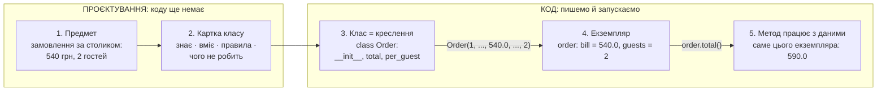
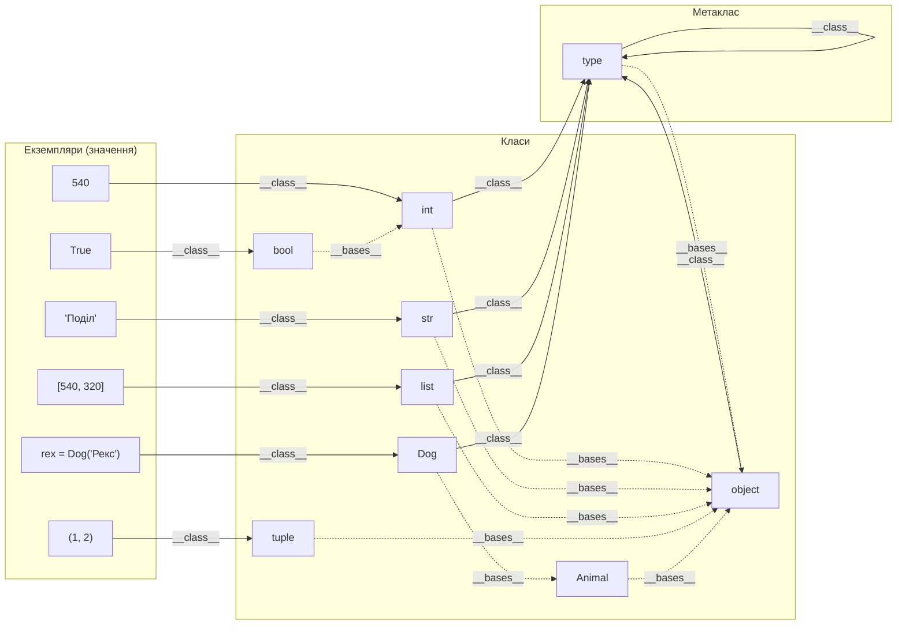
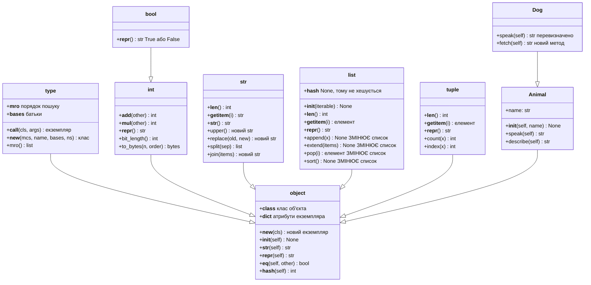
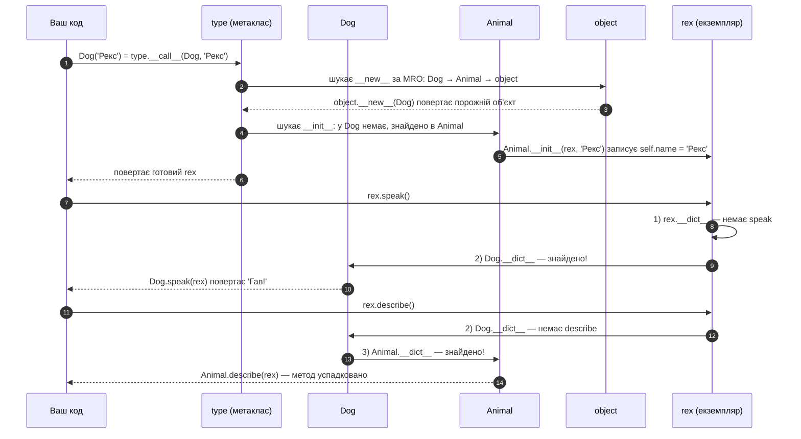
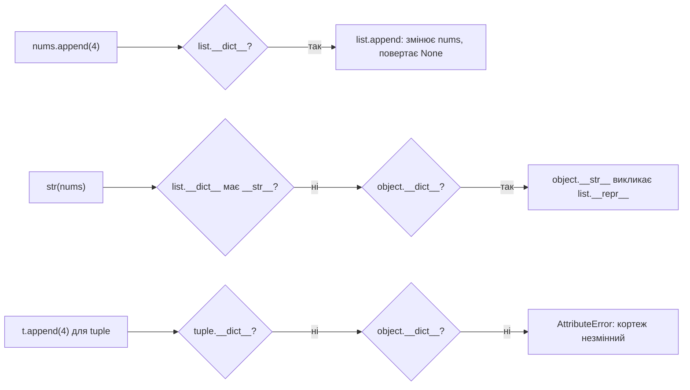
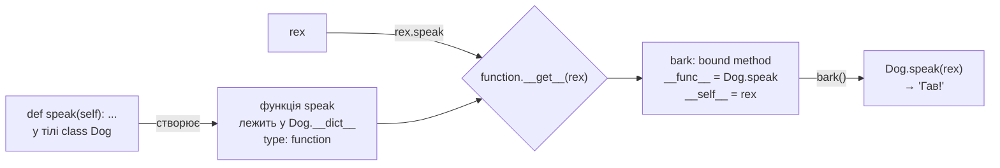
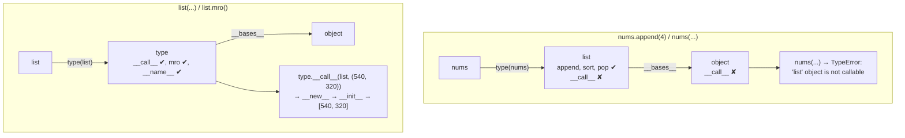

# 🧠 Ментальна модель класів Python

> Довідник-схема класів для всього курсу (уроки 19–24). Основний урок — 20.
> Читайте паралельно з `note_lesson_20_classes.ipynb`.
> Інтерактивна карта класів і методів: відкрийте `classes_object_map.html` у браузері.

---

## Як читати: два рівні

Цей довідник — ментальна модель класів **для всього курсу**, а не лише для уроку 20. Кожен розділ позначено рівнем:

| Рівень | Що в ньому | Розділи | Уроки |
|---|---|---|---|
| 🟢 **Beginner** | об'єкт → клас → метод; проєктування класу; `self`; простір імен; створення через `__new__` / `__init__`; змінні й незмінні типи; функції як об'єкти | 0, 1, 3–8, 10, 12, 15 | 19–21 |
| 🔴 **Advanced** | клас теж об'єкт: метаклас `type` і правило виклику `X(...)`; два зв'язки (`__class__` / `__bases__`); bound methods; MRO (C3); дескриптори; межі спрощень | 2, 9, 11, 13, 16, 17 | 21–24 |

**Порядок:** спершу пройдіть усі 🟢. До 🔴 повертайтеся, коли 🟢 уже не викликає питань. У [інтерактивній карті](classes_object_map.html) той самий перемикач: 🟢 Beginner / 🔴 Advanced.

---

## 0. 🟢 Спершу проєктуємо: від ідеї до екземпляра

Клас починається **не з коду**. Спершу відповідаємо на п'ять запитань — це **картка класу**:

```
  ┌──────────────────────────────────────────────────────────────────┐
  │  КАРТКА КЛАСУ                                                    │
  │                                                                  │
  │  1. Що це за річ?        іменник        →  class Order:          │
  │  2. Що вона знає?        дані / стан    →  self.bill = bill      │
  │  3. Що вона вміє?        дієслова       →  def total(self): ...  │
  │  4. Які правила тримає?  «завжди так»   →  перевірка в __init__  │
  │  5. Чого НЕ робить?      межа           →  це робить інший клас  │
  └──────────────────────────────────────────────────────────────────┘
```

Повний шлях — від предмета в житті до виклику методу:



**Картка для замовлення кафе:**

| Запитання | Відповідь | Що з'явиться в коді |
|---|---|---|
| Що це за річ? | замовлення; кожне окреме | `class Order:`; кожне замовлення — `Order(...)` |
| Що воно знає? | номер, час, чек, чайові, гостей | `self.id`, `self.time`, `self.bill`, `self.tip`, `self.guests` |
| Що воно вміє? | сума з чайовими, сума на гостя, показати себе | `total()`, `per_guest()`, `__repr__()` |
| Які правила тримає? | чек > 0, гостей ≥ 1 | `raise ValueError` в `__init__` |
| Чого НЕ робить? | не видає собі номер, не знає про доставку і `print` | номер видає `DeliveryService` |

**Вбудовані класи теж хтось так спроєктував** — тому вони поводяться по-різному:

| Клас | Знає | Вміє | Правило |
|---|---|---|---|
| `str` | символи | `upper()`, `split()`, `replace()` | незмінний → методи повертають **новий** рядок |
| `list` | елементи по порядку | `append()`, `sort()`, `pop()` | змінний → методи міняють **той самий** список |
| `tuple` | елементи по порядку | `count()`, `index()` | незмінний → `append` і `sort` **немає взагалі** |

**Три типові помилки проєктування:**

1. Почати з коду — методи з'являються «бо треба», клас стає смітником функцій.
2. Клас без жодного «вміє» — можливо, досить `NamedTuple` або `dict`.
3. Клас, що робить усе (читає файл, рахує, друкує) — у п'ятому запитанні має бути відповідь.

---

## 1. 🟢 Все є об'єктом — ієрархія типів

```
                    ┌──────────┐
                    │  object  │  ← прабатько ВСЬОГО в Python
                    └────┬─────┘
          ┌──────────────┼──────────────┐──────────┐
          ▼              ▼              ▼          ▼
       ┌─────┐        ┌─────┐       ┌──────┐   ┌──────┐
       │ int │        │ str │       │ list │   │ dict │  ...інші вбудовані класи
       └──┬──┘        └──┬──┘       └──┬───┘   └──────┘
          ▼              ▼             ▼
         5, 42         'hi'       [1, 2, 3]       ← екземпляри (конкретні об'єкти)
```

**Висновок:** Ваш власний клас `class Dog(Animal):` теж автоматично потрапляє в це дерево.

---

## 2. 🔴 Мета-рівень: type створює класи

```
                  ┌──────┐
                  │ type │ ← метаклас; стрілка на себе (type є екземпляром type)
                  └───┬──┘
        ┌─────────────┼────────────┐
        ▼             ▼            ▼
     ┌─────┐       ┌─────┐     ┌──────┐
     │ int │       │ str │     │  Dog │  ← усі класи є об'єктами класу `type`
     └──┬──┘       └──┬──┘     └──┬───┘
        ▼             ▼           ▼
       5, 42        'hi'        dog1      ← екземпляри класів
```

```python
type(5)     # → int    (5 є екземпляром int)
type(int)   # → type   (int є екземпляром type)
type(type)  # → type   (type є екземпляром самого себе)
```

---

## 3. 🟢 Клас як фабрика об'єктів

```
  ┌─────────────────────────────────┐
  │          class Dog:             │  ← КЛАС = "форма для печива" / фабрика
  │   species = 'Canis'             │    (зберігається в пам'яті як об'єкт)
  │   def __init__(self, name): ... │
  │   def speak(self): ...          │
  └────────────────┬────────────────┘
                   │  dog1 = Dog('Рекс')
        ┌──────────┼──────────┐
        ▼          ▼          ▼
   ┌─────────┐ ┌─────────┐ ┌─────────┐
   │  dog1   │ │  dog2   │ │  dog3   │  ← ЕКЗЕМПЛЯРИ (конкретні об'єкти)
   │name=Рекс│ │name=Лайка│ │name=Шарик│
   └─────────┘ └─────────┘ └─────────┘
```

---

## 4. 🟢 Ярлики vs Коробки — модель пам'яті

### Стара (неправильна) модель:
```
a ┌───────┐    b ┌───────┐
  │  [1,2]│      │  [1,2]│   ← неправильно: два окремих списки
  └───────┘      └───────┘
```

### Правильна модель Python:
```
      ┌─────────────────┐
      │  [1, 2, 3]      │  ← один об'єкт-список у пам'яті
      └────────┬────────┘
               │  (одна адреса пам'яті)
         ┌─────┴─────┐
         │           │
         a           b       ← два ярлики на один об'єкт
```

```python
a = [1, 2, 3]
b = a
b.append(4)
print(a)           # [1, 2, 3, 4] — змінився!
print(id(a) == id(b))  # True — один об'єкт
```

**Копія потрібна явно:** `b = a.copy()` або `b = list(a)`

---

## 5. 🟢 Простір імен: клас vs екземпляр

```
  ┌─────────────────────────┐
  │     Dog.__dict__        │  ← простір імен КЛАСУ
  │  species = 'Canis'      │     (спільний для всіх)
  │  speak = <function>     │
  └────────────┬────────────┘
               │  Python шукає тут, якщо не знайшов в екземплярі
       ┌───────┴───────┐
       ▼               ▼
  ┌─────────────┐  ┌──────────────┐
  │ dog1.__dict__│  │ dog2.__dict__ │  ← простір імен ЕКЗЕМПЛЯРІВ
  │ name = 'Рекс'│  │ name = 'Лайка'│    (особистий кожного)
  └─────────────┘  └──────────────┘
```

**Порядок пошуку атрибута `dog1.x`:**
```
1. dog1.__dict__  →  знайдено? Стоп.
2. Dog.__dict__   →  знайдено? Стоп.
3. Батьківські класи (MRO)
4. AttributeError
```

> 🔴 Це спрощений порядок. Як `@property` змінює його — розділ 17.

---

## 6. 🟢 self — посилання на екземпляр

```python
dog1.speak()
# Python перетворює на:
Dog.speak(dog1)   # dog1 передається як self
```

```
  dog1.speak()
       │
       ▼
  Dog.speak(self=dog1)
                 │
                 └──► self.name  →  dog1.name  →  'Рекс'
```

---

## 7. 🟢 LEGB та класи

```
┌──────────────────────────────────────┐
│  G — Global: X = 'глобальна'         │
│                                      │
│  ┌────────────────────────────────┐  │
│  │  class MyClass:                │  │  ← НЕ є Enclosing (E)!
│  │      X = 'класова'             │  │    Методи не "бачать" X напряму
│  │                                │  │
│  │      def show(self):           │  │
│  │      ┌─────────────────────┐   │  │
│  │      │ L — Local:          │   │  │
│  │      │   X = 'локальна'    │   │  │
│  │      │   print(X)          │──►│──┘ знаходить 'локальна'
│  │      │   print(self.X)     │──►│    знаходить 'класова' через self
│  │      └─────────────────────┘   │
│  └────────────────────────────────┘
└──────────────────────────────────────┘
```

**Правило:**
- `print(X)` без `self` → шукає L → E → **G** (клас пропускається!)
- `print(self.X)` → шукає в екземплярі → потім у класі ✅

---

## 8. 🟢 isinstance vs type vs issubclass

```
  class Animal: pass
  class Bird(Animal): pass

  duck = Bird()

  ┌──────────────────────────────────────────────────────┐
  │ type(duck) is Bird     → True   (точний клас)        │
  │ type(duck) is Animal   → False  (не враховує ієрархію)│
  ├──────────────────────────────────────────────────────┤
  │ isinstance(duck, Bird)   → True  (прямий клас)       │
  │ isinstance(duck, Animal) → True  (батьківський клас) │  ← використовуйте це
  ├──────────────────────────────────────────────────────┤
  │ issubclass(Bird, Animal) → True  (між класами)       │
  │ issubclass(Bird, Fish)   → False                     │
  └──────────────────────────────────────────────────────┘
```

---

## 9. 🔴 Повна картина: від `type` до екземпляра

```
   type  ──────creates──────►  int  ──────creates──────►  5
   type  ──────creates──────►  str  ──────creates──────►  'hello'
   type  ──────creates──────►  Dog  ──────creates──────►  dog1
   type  ──────creates──────►  type  (сам себе!)

   Все ──is-instance-of──►  object
```

---

## 10. 🟢 Шпаргалка: дандер-методи початківця

| Метод | Коли викликається | Приклад |
|-------|-------------------|---------|
| `__init__(self, ...)` | `MyClass(args)` | Ініціалізація об'єкта |
| `__str__(self)` | `print(obj)`, `str(obj)` | Людиночитабельний вивід |
| `__repr__(self)` | `repr(obj)`, консоль | Технічний вивід для дебагу |
| `__len__(self)` | `len(obj)` | Довжина об'єкта |
| `__eq__(self, other)` | `obj1 == obj2` | Порівняння на рівність |
| `__add__(self, other)` | `obj1 + obj2` | Оператор `+` |

---

## 11. 🔴 Два різні зв'язки: «є екземпляром» і «успадковується від»

У Python між об'єктами є **два різні види стрілок**, і їх не можна плутати:

| Зв'язок | Як перевірити | Приклад |
|---|---|---|
| **є екземпляром** (instance of) | `x.__class__`, `type(x)`, `isinstance(x, X)` | `540.__class__ is int` |
| **успадковується від** (inherits from) | `X.__bases__`, `X.__mro__`, `issubclass(A, B)` | `int.__bases__ == (object,)` |

На схемі: **суцільна стрілка** = `__class__`, **пунктирна стрілка** = `__bases__`.



> Щоб схема не була перевантажена, стрілки `__class__ → type` показано не для всіх класів.
> Але **кожен** клас (`bool`, `tuple`, `Animal` теж) — це екземпляр `type`.

**Парадокс, який треба просто запам'ятати:**

```python
type(type) is type          # True — type є екземпляром самого себе
type(object) is type        # True — object є екземпляром type
type.__bases__ == (object,) # True — а type успадковується від object
object.__bases__ == ()      # True — у object батьків немає
```

---

## 12. 🟢 UML: класи та їхні методи

Як читати:
- `object <|-- int` — `int` **успадковується** від `object`;
- `+append(x) None` — метод `append` повертає `None`, бо **змінює сам список**;
- `+upper() str` — метод повертає **новий** рядок, старий не змінюється.



**Що видно з цієї схеми (перевірено в Python):**

| Факт | Перевірка | Наслідок |
|---|---|---|
| У `list`, `tuple`, `int` немає власного `__str__` | `'__str__' in list.__dict__` → `False` | `print([1, 2])` бере `object.__str__`, а той викликає `list.__repr__` |
| У `tuple` немає власного `__init__` | `'__init__' in tuple.__dict__` → `False` | кортеж повністю створюється в `__new__`, бо він незмінний |
| У `list` `__hash__ = None` | `list.__hash__ is None` → `True` | список не можна зробити ключем `dict` |
| У `Dog` є лише `speak` і `fetch` | `Dog.__dict__` | `__init__` і `describe` `Dog` **успадковує** від `Animal` |
| `bool` — підклас `int` | `bool.__mro__` → `(bool, int, object)` | `True + True == 2` |

**Методи за тим, що вони роблять з об'єктом:**

| Тип | Змінює сам об'єкт (повертає `None`) | Повертає новий об'єкт або значення |
|---|---|---|
| `list` | `append`, `extend`, `insert`, `pop`*, `remove`, `sort`, `reverse`, `clear` | `copy`, `count`, `index`, `+`, зріз `[a:b]` |
| `tuple` | — (незмінний) | `count`, `index`, `+`, зріз |
| `str` | — (незмінний) | `upper`, `lower`, `replace`, `strip`, `split`, `join` |
| `int` | — (незмінний) | `+`, `*`, `bit_length`, `to_bytes` |

\* `pop` змінює список **і** повертає вилучений елемент.

---

## 13. 🔴 Життєвий шлях об'єкта: від `Dog('Рекс')` до виклику методу

Що відбувається, коли ви пишете `rex = Dog('Рекс')`, а потім `rex.speak()` і `rex.describe()`:



Код, яким можна перевірити кожен крок:

```python
class Animal:
    def __init__(self, name):
        print(f'  Animal.__init__: self.name = {name!r}')
        self.name = name

    def speak(self):
        return '...'

    def describe(self):
        return f'{self.name} каже {self.speak()}'


class Dog(Animal):
    def speak(self):            # перевизначаємо метод батька
        return 'Гав!'

    def fetch(self):            # новий метод, якого немає в Animal
        return f'{self.name} приносить палицю'


print('Створюємо rex:')
rex = Dog('Рекс')

print('rex.__dict__   =', rex.__dict__)                 # {'name': 'Рекс'}
print('Dog.__dict__   =', [k for k in Dog.__dict__ if not k.startswith('__')])  # ['speak', 'fetch']
print('Dog.__mro__    =', [c.__name__ for c in Dog.__mro__])  # ['Dog', 'Animal', 'object']
print('rex.speak()    =', rex.speak())                  # Гав!  — з Dog
print('rex.describe() =', rex.describe())               # Рекс каже Гав!  — з Animal, але speak з Dog
print('str(rex)       =', str(rex)[:25], '...')         # <__main__.Dog object ... — з object
```

**Той самий механізм працює і для вбудованих типів:**



---

## 14. Інтерактивна карта

Файл `classes_object_map.html` (відкривається в будь-якому браузері, інтернет не потрібен):

- **Перемикач рівня** 🟢 Beginner / 🔴 Advanced — на Beginner приховано метаклас, bound methods і деталі пошуку; на Advanced видно все плюс блок «Межі моделі»;

- **Дерево класів** — клікніть клас, щоб побачити його **власні** та **успадковані** методи і що кожен робить з об'єктом;
- **Як створюються** — покроково: об'єкт класу (`Dog('Рекс')` → `__new__` → `__init__`), функції (`def`, `lambda`, замикання) і методи (метод у класі, bound method, `@classmethod` / `@staticmethod`);
- **Пошук методу** — оберіть об'єкт і метод, і карта покаже шлях пошуку за MRO та де саме метод знайдено.
- **Функції та bound methods** — об'єкти `apply_discount`, `next_id` (замикання) і `bark = rex.speak`;
- **Клас теж об'єкт** — для кожного класу два ланцюжки пошуку: для екземплярів і для самого класу (через `type`).

---

## 15. 🟢 Функції — теж об'єкти

Функція (урок 19) — такий самий об'єкт, як `540` чи `[1, 2]`. Її створює оператор `def`, а її клас — `function`:

```python
def apply_discount(bill, percent=10):
    """Знижка на чек."""
    return round(bill * (1 - percent / 100), 2)

print(type(apply_discount))          # <class 'function'>
print(type(apply_discount).__bases__) # (<class 'object'>,)
print(apply_discount.__name__)       # apply_discount
print(apply_discount.__defaults__)   # (10,)   — значення за замовчуванням живуть в об'єкті
print(apply_discount(540.0))         # 486.0   — виклик = function.__call__
apply_discount.calls = 0             # у функції є свій __dict__!
print(apply_discount.__dict__)       # {'calls': 0}
```

**Методи — це функції, що лежать у класі.** Коли пишете `rex.speak` **без дужок**, Python бере функцію з `Dog.__dict__` і загортає її разом з `rex` в об'єкт `method` (bound method):

```python
print(type(Dog.__dict__['speak']))   # <class 'function'>  — у класі лежить звичайна функція
bark = rex.speak                     # дужок немає: метод ще НЕ викликано
print(type(bark))                    # <class 'method'>
print(bark.__self__ is rex)          # True  — до кого прив'язано (майбутній self)
print(bark.__func__ is Dog.speak)    # True  — яка функція всередині
print(bark())                        # Гав!  — те саме, що Dog.speak(rex)
print(rex.speak is rex.speak)        # False — кожне звернення створює НОВИЙ method
```



Ось звідки береться `self`: bound method пам'ятає об'єкт (`__self__`) і підставляє його першим аргументом.

| Об'єкт | `type(...)` | Звідки береться | Чи можна викликати `(...)` |
|---|---|---|---|
| `apply_discount` | `function` | `def` | ✅ у `function` є `__call__` |
| `lambda x: x` | `function` | `lambda` | ✅ |
| `len` | `builtin_function_or_method` | вбудована, написана на C | ✅ |
| `Dog.speak` | `function` | `def` у тілі класу | ✅ але `self` треба передати самому: `Dog.speak(rex)` |
| `rex.speak` | `method` | `function.__get__` при зверненні через об'єкт | ✅ `self` підставляється сам |

### 🟢 Як створюються функції і методи: шість прикладів

**1. `def` — створення функції.** Рядок `def` тіло **не виконує**, а лише створює об'єкт-функцію і вішає на нього ярлик:

```python
def apply_discount(bill, percent=10):   # тут тіло НЕ виконується
    """Знижка на чек."""
    return round(bill * (1 - percent / 100), 2)

print(type(apply_discount))   # <class 'function'>  — об'єкт уже є
print(apply_discount(540.0))  # 486.0  — тіло виконується лише при виклику
d = apply_discount            # ще один ярлик на той самий об'єкт
print(d is apply_discount)    # True
```

**2. `lambda` — функція одним виразом.** Створює такий самий `function`, тільки без імені:

```python
half = lambda bill: bill * 0.9
print(type(half), half.__name__)  # <class 'function'> <lambda>
print(half(540))                  # 486.0
```

**3. Замикання — функція, яку створює інша функція.** Кожен виклик фабрики створює **нову** функцію зі **своєю** пам'яттю:

```python
def make_counter():
    count = 0
    def next_id():          # створюється ЩОРАЗУ, коли викликають make_counter()
        nonlocal count
        count += 1
        return count
    return next_id

a = make_counter()
b = make_counter()
print(a(), a(), b())        # 1 2 1
print(a is b)               # False — дві різні функції
```

**4. Метод — функція, що лежить у класі.** Тіло класу виконується один раз, і `def` кладе функцію в `Dog.__dict__`:

```python
class Dog(Animal):
    def speak(self):            # звичайна функція…
        return 'Гав!'

print(type(Dog.__dict__['speak']))  # <class 'function'>  …що лежить у класі
rex = Dog('Рекс')
print(Dog.speak(rex))   # Гав! — через клас self передаємо самі
print(rex.speak())      # Гав! — через об'єкт self підставляється сам
```

**5. Bound method — метод, прив'язаний до об'єкта.** `rex.speak` без дужок — це метод, який уже пам'ятає `rex`:

```python
bark = rex.speak        # дужок немає — ще НЕ викликано
print(bark())           # Гав!  — self = rex
```

**6. `@classmethod` і `@staticmethod`** — інший перший аргумент:

| Вид | Перший аргумент | Приклад |
|---|---|---|
| звичайний метод | `self` — об'єкт | `order.total()` |
| `@classmethod` | `cls` — клас | `Order.from_line('7')` — альтернативний конструктор |
| `@staticmethod` | — нічого | `Order.meal_type(12)` — правило без даних об'єкта |

### 🔴 Що відбувається всередині

| Що пишемо | Що створюється | Деталі |
|---|---|---|
| `def f(x, k=10): ...` | `function` з `__code__` (рецепт), `__globals__`, `__defaults__`, `__name__`, `__dict__` | `__defaults__ = (10,)` обчислюється **один раз** при `def` — звідси пастка `def f(items=[])` |
| `lambda x: ...` | той самий `function`, `__name__ == '<lambda>'` | тіло читає змінні **в момент виклику** (пастка нижче) |
| `make_counter()` | новий `function` з тим самим `__code__`, але своїм `__closure__` | `a.__code__ is b.__code__` → `True`; `count` живе в комірці (cell) |
| `class Dog: def speak` | тіло класу → словник `ns` → `type('Dog', (Animal,), ns)` | `Dog.speak is Dog.__dict__['speak']` → `True` |
| `rex.speak` | `Dog.__dict__['speak'].__get__(rex, Dog)` → новий `method` | `__func__ is Dog.speak`, `__self__ is rex`; `rex.speak is rex.speak` → `False` |
| `@classmethod` / `@staticmethod` | обгортки-дескриптори в `__dict__` класу | `__get__` дає `method` з `__self__ = cls` / саму функцію |

```python
# Пастка пізнього зв'язування в lambda
fs = [lambda: i for i in range(3)]
print([f() for f in fs])          # [2, 2, 2] — i читається при виклику
fs = [lambda i=i: i for i in range(3)]
print([f() for f in fs])          # [0, 1, 2] — i=i фіксує значення при створенні

# Без nonlocal замикання ламається
def make_counter():
    count = 0
    def next_id():
        count += 1                # UnboundLocalError: count стала локальною
        return count
    return next_id

# Bound method вручну — саме це робить rex.speak
f = Dog.__dict__['speak']
bark = f.__get__(rex, Dog)
print(bark.__self__ is rex, bark.__func__ is f)   # True True

# classmethod прив'язується до класу навіть через об'єкт
print(type(Order.__dict__['from_line']))   # <class 'classmethod'>
print(Order.from_line.__self__)            # <class 'Order'>
print(type(Order.meal_type))               # <class 'function'>
```

У карті ці шість прикладів покроково є на вкладці **«2. Як створюються»**: група «Функції» та група «Методи», для кожного рівня окремі кроки.

---

## 16. 🔴 Методи `type` — це методи КЛАСУ, а не екземплярів

Чому `list((540, 320))` працює, а `nums()` дає помилку? Чому `list.mro()` працює, а `nums.mro()` — ні?

```python
nums = [540, 320]

print(list((540, 320)))     # [540, 320]
print(list.mro())           # [<class 'list'>, <class 'object'>]
print(list.__name__)        # list

nums()          # TypeError: 'list' object is not callable
nums.mro()      # AttributeError: 'list' object has no attribute 'mro'
nums.__name__   # AttributeError: 'list' object has no attribute '__name__'
```

### Головне: `list` НЕ успадковує від `type`

```python
print(list.__mro__)            # (<class 'list'>, <class 'object'>)   ← type тут НЕМАЄ
print(issubclass(list, type))  # False
print(type(list))              # <class 'type'>                       ← list — ЕКЗЕМПЛЯР type
print(isinstance(list, type))  # True
```

`list` отримує `__call__`, `mro` і `__name__` не через успадкування (пунктир `__bases__`), а тому, що **сам `list` — об'єкт класу `type`** (суцільна стрілка `__class__`). Для об'єкта Python шукає методи в **його класі**. А клас об'єкта `list` — це `type`.

Те саме правило, що й для `nums`, просто на поверх вище:

| Об'єкт | Його клас `type(об'єкт)` | Де шукаються методи об'єкта |
|---|---|---|
| `nums` | `list` | `list.__mro__` = `list → object` → є `append`, `sort`... |
| `list` | `type` | `type.__mro__` = `type → object` → є `__call__`, `mro`, `__name__`... |

### Два ланцюжки пошуку



### Що саме відбувається при `list((540, 320))`

```python
# що ви пишете:
nums2 = list((540, 320))

# що робить Python — шукає __call__ у type(list), а не в list:
nums2 = type(list).__call__(list, (540, 320))   # type(list) is type
#   всередині type.__call__:
#     obj = list.__new__(list, (540, 320))      # порожній []
#     list.__init__(obj, (540, 320))            # заповнює → [540, 320]
#     return obj
```

### 📌 Правило виклику: Python питає не `X`, а клас `X`

Коли ви пишете `X(...)`, Python звертається не до самого `X`, а до **його класу**: «Ти вмієш викликати такі об'єкти?» Тобто він шукає `__call__` у `type(X)`.

**Три кроки, які Python робить для `X(...)`:**

1. Взяти клас об'єкта: `type(X)`.
2. Шукати `__call__` по ланцюжку `type(X).__mro__`. У `X.__dict__` він **не** дивиться.
3. Знайшов → виконати `type(X).__call__(X, ...)`. Не знайшов → `TypeError: '<клас>' object is not callable`.

Порівняймо клас `str` і рядок `city`:

```python
city = "Поділ"

str("Київ")   # ✅ 'Київ'
city()        # ❌ TypeError: 'str' object is not callable
```

| | `str` | `city` |
|---|---|---|
| Що це? | клас | рядок — екземпляр `str` |
| `type(...)` | `type` | `str` |
| Де Python шукає `__call__`? | `type → object` | `str → object` |
| Чи є там `__call__`? | ✅ так, `type.__call__` | ❌ ні |
| Можна викликати `(...)`? | ✅ `str("Київ")` | ❌ `city()` → `TypeError` |
| `callable(...)` | `True` | `False` |

Не важливо, що таке `X`: клас, функція чи звичайний об'єкт. Важливо, чи вміє викликати **його клас**:

| `X` | `type(X)` | `__call__` у `type(X)`? | `X(...)` |
|---|---|---|---|
| `str`, `list`, `Dog` | `type` | ✅ `type.__call__` | ✅ створює екземпляр |
| `apply_discount` | `function` | ✅ `function.__call__` | ✅ виконує тіло функції |
| `rex.speak` | `method` | ✅ `method.__call__` | ✅ викликає `Dog.speak(rex)` |
| `city`, `nums`, `540` | `str`, `list`, `int` | ❌ | ❌ `TypeError` |
| `rex` | `Dog` | ❌ поки в `Dog` немає `def __call__` | ❌ `TypeError` |

**Перевірити без виклику** можна функцією `callable()`:

```python
print(callable(str))       # True  — у type є __call__
print(callable("Поділ"))   # False — у str немає __call__
print(callable(len))       # True
print(callable(rex))       # False — поки в Dog немає __call__
```

`callable(X)` відповідає лише на питання «чи має клас `X` метод `__call__`». Сам виклик усе одно може впасти, наприклад через неправильні аргументи.

**Перевір себе.**

```python
class River:
    pass

river = River()
river()        # спрацює?
```

1. Так, адже `River` — клас.
2. Ні, бо в `River` (і в `object`) немає `__call__`.
3. Так, адже `type(River)` — це `type`.

<details>
<summary>Відповідь</summary>

**2.** Викликаємо `river`, тож Python дивиться в `type(river)` = `River` → `object`. `__call__` там немає, тому буде `TypeError: 'River' object is not callable`.

Варіанти 1 і 3 описують виклик **класу** `River()`: його клас — `type`, і в нього `__call__` є. Тому `River()` працює, а `river()` — ні. `callable(River)` → `True`, `callable(river)` → `False`.

</details>

### Перевірка: додамо `__call__` у свій клас

```python
class Dog(Animal):
    def __call__(self):              # тепер ЕКЗЕМПЛЯРИ Dog можна викликати
        return f'{self.name}: Гав!'

rex = Dog('Рекс')
print(rex())                # Рекс: Гав!   — працює Dog.__call__, бо type(rex) is Dog
print(Dog('Бобік').name)    # Бобік        — Dog(...) і далі йде через type.__call__
```

`Dog.__call__` впливає на `rex()`, але **не** на `Dog(...)`. Створення об'єкта керується класом класу, тобто `type`.

Ще одна деталь: для `(...)` Python бере `__call__` **з класу**, а в `__dict__` самого об'єкта не дивиться:

```python
cat = Animal('Мурка')
cat.__call__ = lambda: 'мяу'   # кладемо в cat.__dict__
cat.__call__()                 # 'мяу' — звичайний пошук атрибута знаходить
cat()                          # TypeError: 'Animal' object is not callable
```

### Підсумок у трьох рядках

```text
nums.append(4)   →  шукаємо в type(nums) = list  → list → object
list(...)        →  шукаємо в type(list) = type  → type → object     (не успадкування, а «є екземпляром»)
rex()            →  шукаємо в type(rex)  = Dog   → Dog → Animal → object
```

В інтерактивній карті клікніть будь-який клас: блок «Клас теж об'єкт» показує обидва ланцюжки для нього.

---

## 17. 🔴 Точніша картина: де спрощують схеми вище

Схеми 🟢 навмисно спрощені. Ось що відбувається насправді (усе перевірено в Python):

| Спрощення | Як насправді | Перевірка |
|---|---|---|
| «Атрибут шукається: `obj.__dict__` → клас → MRO» | спершу **дескриптори даних** у класі (`@property`), потім `obj.__dict__`, потім решта атрибутів класу | `property` перемагає запис у `obj.__dict__` (див. нижче) |
| «`Клас(...)` = `__new__`, потім `__init__`» | `__init__` викликається, **лише** якщо `__new__` повернув екземпляр цього класу | `__new__` повертає `42` → `__init__` пропущено |
| «`copy()` створює новий список» | копія **поверхнева**: новий лише зовнішній список, вкладені об'єкти спільні | `c[0] is nums[0]` → `True` |
| «Кортеж незмінний — отже хешується» | хешується, лише якщо **всі елементи** хешовані | `hash(([1, 2], 540))` → `TypeError` |
| «`object.__eq__` порівнює `is`» | для різних об'єктів повертає `NotImplemented`; тоді `==` пробує `other.__eq__` і в підсумку дає `False` | `object.__eq__(x, y)` → `NotImplemented` |
| «MRO — це ланцюжок батьків» | для множинного успадкування Python будує MRO **алгоритмом C3** | `class S(Q, R)`, де `Q` і `R` успадковують `P` → `S, Q, R, P, object` |

```python
# 1. Дескриптор даних (property) сильніший за __dict__ екземпляра
class B:
    @property
    def name(self):
        return 'з property'

b = B()
b.__dict__['name'] = 'з __dict__'
print(b.name)          # з property

# 2. __init__ не викликається, якщо __new__ повернув «чужий» об'єкт
class C:
    def __new__(cls):
        return 42
    def __init__(self):
        print('INIT')  # не надрукується

print(C())             # 42

# 3. Поверхнева копія
nums = [[1, 2], 540]
c = nums.copy()
c[0].append(3)
print(nums)                       # [[1, 2, 3], 540] — вкладений список спільний
print(c is nums, c[0] is nums[0]) # False True

# 4. Хеш кортежу
print(hash((540, 320)) is not None)  # True
# hash(([1, 2], 540))                # TypeError: unhashable type: 'list'

# 5. object.__eq__ і NotImplemented
class A:
    pass

x, y = A(), A()
print(object.__eq__(x, y), x == y)   # NotImplemented False

# 6. C3: множинне успадкування (урок 21)
class P: pass
class Q(P): pass
class R(P): pass
class S(Q, R): pass

print([k.__name__ for k in S.__mro__])  # ['S', 'Q', 'R', 'P', 'object']
```

**Чому тоді схеми 🟢 не «неправильні»?** Для класів без `property`, без множинного успадкування й без незвичного `__new__` вони дають той самий результат, що й Python. Точна картина потрібна, коли з'являються ці інструменти: уроки 21 (множинне успадкування, `super`) і 24 (`@property`, дескриптори, dunder-методи).
